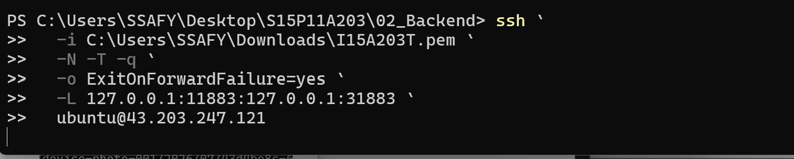
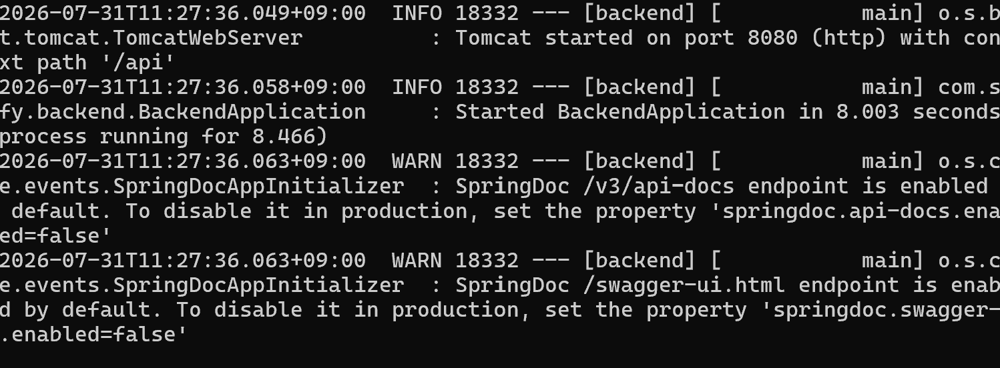
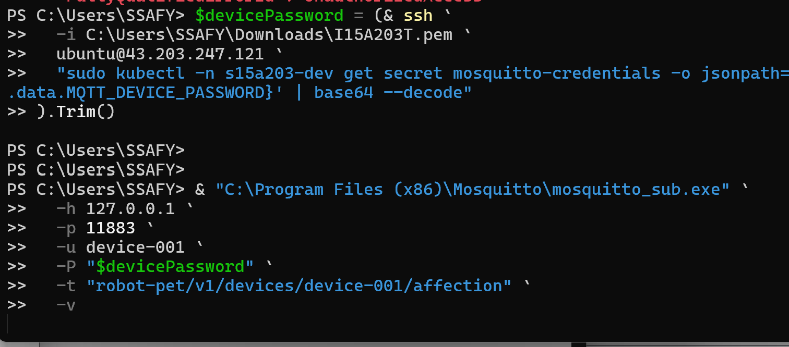
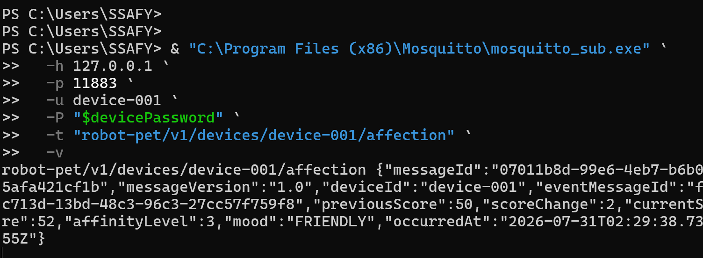

# MQTT API 로컬 테스트

## 테스트 범위

로봇 디바이스의 행동 이벤트·heartbeat·행동 요청 결과를 MQTT로 처리합니다.
호감도 변경과 서버 행동 요청을 디바이스 토픽으로 발행하며, 메시지 처리 오류가 MQTT 재접속 루프로 이어지지 않도록 채널 예외를 격리합니다.

## 변경 유형 (Type of change)

- [x] 🚀 기능 추가 (feat)
- [x] 🐛 버그 수정 (fix)
- [x] 📝 문서 (docs)
- [x] 🧪 테스트 (test)
- [x] ⚙️ 설정/빌드 (chore)

## 반영 브랜치

`feat/BE/robot_MQTT_API` → `dev`

## 주요 변경 내용 (What changed)

- Mosquitto StatefulSet, PVC, 인증 Secret 및 ACL 구성
- 디바이스 이벤트·heartbeat·요청 결과 MQTT 수신
- 행동 이벤트 저장과 호감도 증감 후 `/affection` 발행
- `PLAY_REQUEST`, `WALK_REQUEST`, `CARE_REQUEST`, `INTERACTION_REQUEST` 생성
- 호감도에 따른 상호작용 주기와 수면 모드 예외 적용
- inbound/outbound 채널 핸들러 명시적 연결
- 처리 실패 메시지 폐기 및 MQTT 재접속 루프 방지
- S3 Presigned URL 기반 이미지 업로드 API
- MQTT/S3 DB 마이그레이션 및 자동화 테스트 추가

## DB 적용

기존 dev DB에는 아래 SQL이 적용되어 있어야 합니다.

```bash
kubectl -n s15a203-dev exec -i postgres-0 -- \
  psql -U "$DB_USER" -d mysil \
  < 06_Infra/postgres/init/002_robot_events.sql

kubectl -n s15a203-dev exec -i postgres-0 -- \
  psql -U "$DB_USER" -d mysil \
  < 06_Infra/postgres/init/004_robot_mqtt_runtime.sql
```

## 리뷰어 테스트 방법 (How to test)

### 1. 자동 테스트

```powershell
cd 02_Backend
.\gradlew.bat --console=plain test
```

예상 결과:

```text
BUILD SUCCESSFUL
```

### 2. SSH 터널

```powershell
ssh `
  -i C:\Users\SSAFY\Downloads\I15A203T.pem `
  -N -T -q `
  -o ExitOnForwardFailure=yes `
  -L 127.0.0.1:11883:127.0.0.1:31883 `
  ubuntu@43.203.247.121
```



### 2.1 새 터미널에서 로컬 스프링 실행
```powershell
cd C:\Users\SSAFY\Desktop\S15P11A203\02_Backend

Get-Content .env |
  Where-Object { $_ -match '^\s*[^#][^=]*=' } |
  ForEach-Object {
    $name, $value = $_ -split '=', 2
    [Environment]::SetEnvironmentVariable(
      $name.Trim(),
      $value.Trim(),
      "Process"
    )
  }

$env:MQTT_ENABLED = "true"
$env:MQTT_URL = "tcp://127.0.0.1:11883"
$env:MQTT_CLIENT_ID = "robot-pet-backend-local-$env:USERNAME"
$env:MQTT_REQUEST_SCHEDULER_ENABLED = "false"

.\gradlew.bat --console=plain bootRun `
  --args="--spring.profiles.active=s3local"
```
Started BackendApplication이 나오면 H2에 device-001 등록과 페어링이 완료된 상태입니다.
Spring을 종료하면 H2 데이터도 삭제되고, 다시 실행하면 초기 호감도 50점으로 재생성됩니다.



### 2.2 새 터미널에서 호감도 응답 구독
```powershell
$devicePassword = (& ssh `
  -i C:\Users\SSAFY\Downloads\I15A203T.pem `
  ubuntu@43.203.247.121 `
  "sudo kubectl -n s15a203-dev get secret mosquitto-credentials -o jsonpath='{.data.MQTT_DEVICE_PASSWORD}' | base64 --decode"
).Trim()


& "C:\Program Files (x86)\Mosquitto\mosquitto_sub.exe" `
  -h 127.0.0.1 `
  -p 11883 `
  -u device-001 `
  -P "$devicePassword" `
  -t "robot-pet/v1/devices/device-001/affection" `
  -v

```



### 2.3 행동 이벤트 발행

$payload.eventType를 변경해서 행동 이벤트를 변경할 수 있음
```powershell
$devicePassword = (& ssh `
  -i C:\Users\SSAFY\Downloads\I15A203T.pem `
  ubuntu@43.203.247.121 `
  "sudo kubectl -n s15a203-dev get secret mosquitto-credentials -o jsonpath='{.data.MQTT_DEVICE_PASSWORD}' | base64 --decode"
).Trim()

$payload = @{
  messageId = [guid]::NewGuid().ToString()
  messageVersion = "1.0"
  deviceId = "device-001"
  occurredAt = (Get-Date).ToUniversalTime().ToString("o")
  eventType = "CALL_AND_RESPONSE"
  data = @{}
} | ConvertTo-Json -Compress

$jsonPath = Join-Path $env:TEMP "mqtt-event.json"

[IO.File]::WriteAllText(
  $jsonPath,
  $payload,
  [Text.UTF8Encoding]::new($false)
)

& "C:\Program Files (x86)\Mosquitto\mosquitto_pub.exe" `
  -h 127.0.0.1 `
  -p 11883 `
  -u device-001 `
  -P "$devicePassword" `
  -t "robot-pet/v1/devices/device-001/events" `
  -q 1 `
  -f "$jsonPath"
```
예상 결과
```json
{
  "deviceId": "device-001",
  "previousScore": 50,
  "scoreChange": 10,
  "currentScore": 60,
  "affinityLevel": 4,
  "mood": "FRIENDLY"
}
```




### 3. 로컬 MQTT pub/sub

`02_Backend/.env`에 backend MQTT 계정을 설정하고 실행합니다.
디바이스 비밀번호는 프롬프트에서 입력하며 저장되지 않습니다.

cd C:\Users\SSAFY\Desktop\S15P11A203

powershell -ExecutionPolicy Bypass -File `
  .\06_Infra\mosquitto\scripts\Test-LocalMqttPubSub.ps1
```
device-001 MQTT password: 비밀번호 입력

예상 결과:

```text
[PASS] device -> broker -> backend subscriber
[PASS] backend -> broker -> device subscriber
[PASS] MQTT local pub/sub test completed
```

### 4. dev 배포 확인

```bash
kubectl -n s15a203-dev get pod -l app=backend
kubectl -n s15a203-dev logs deployment/backend --since=5m
```

확인 항목:

- Backend Pod `1/1 Running`
- `mqttInbound` 시작
- inbound/outbound 채널 subscriber 각 1개
- `Dispatcher has no subscribers` 없음
- `Lost connection` 반복 없음

## MQTT 주요 토픽

| 방향 | 토픽 |
|---|---|
| 디바이스 → 서버 | `robot-pet/v1/devices/{deviceId}/events` |
| 디바이스 → 서버 | `robot-pet/v1/devices/{deviceId}/heartbeat` |
| 디바이스 → 서버 | `robot-pet/v1/devices/{deviceId}/request-results` |
| 서버 → 디바이스 | `robot-pet/v1/devices/{deviceId}/affection` |
| 서버 → 디바이스 | `robot-pet/v1/devices/{deviceId}/requests` |

## 산책 완료 HTTP 연동

산책 완료는 디바이스가 MQTT `WALK_COMPLETED`와 HTTP 요청을 둘 다 보내는
방식이 아니라 다음 HTTP 요청 하나로 처리합니다.

```http
POST /api/v1/walks/{walkId}/end
Authorization: Device {DEVICE_HTTP_TOKEN}
Content-Type: application/json

{
  "endedAt": "2026-08-03T03:00:00Z"
}
```

백엔드는 산책 완료, 행동 이벤트 저장, 호감도 +10을 같은 트랜잭션으로 처리하고
커밋 후 변경 결과만 `/affection`으로 발행합니다. `/events`는 디바이스 → 서버
전용이므로 백엔드가 해당 토픽으로 완료 이벤트를 되쏘지 않습니다.

> `/walks/{walkId}/end` 호출 후 별도의 `WALK_COMPLETED` MQTT 이벤트를
> 전송하지 않습니다.


## 체크리스트

- [ ] 전체 Gradle 테스트 통과
- [ ] 로컬 MQTT 양방향 pub/sub 통과
- [ ] dev DB 마이그레이션 확인
- [ ] dev Pod 및 MQTT 연결 로그 확인
- [ ] MQTT/S3 비밀번호와 AWS 키가 커밋되지 않았는지 확인
- [ ] 등록된 로봇·활성 페어링으로 호감도 왕복 확인
